# Stub

**A private archive of every film you saw in a room with strangers.**

Built for one moment: the ninety seconds after the lights come up, the ticket in your pocket or your inbox. Press **Keep a stub** on the Lock Screen, hold the phone over the ticket, and it is read on the phone and kept, in under ten seconds, one-handed, with no signal. Or share in the Wallet pass, the PDF, the booking email or the screenshot the cinema sent. Later you get two things back: the stub as it was, and an **edition**, a ticket designed for that film's release, printed with your own seat and night, lit by the phone and felt under your finger. No two are alike: see a film again and that viewing pulls a **variant**, the same drawing in its own inks. Take it to the **press** and pull your own proof of it, and send it turning in the light. Nothing reaches anyone but you: the drawer lives on the phone and, unless you say otherwise, in your own private iCloud. The App Store label is **Data Not Collected**.

Native Swift and SwiftUI, Metal, Vision, Foundation Models, Core Haptics, App Intents, WidgetKit, CloudKit. iOS 26, built and proved in the iOS 27 simulator, measured against budgets set from Apple's own guidance.

<p>
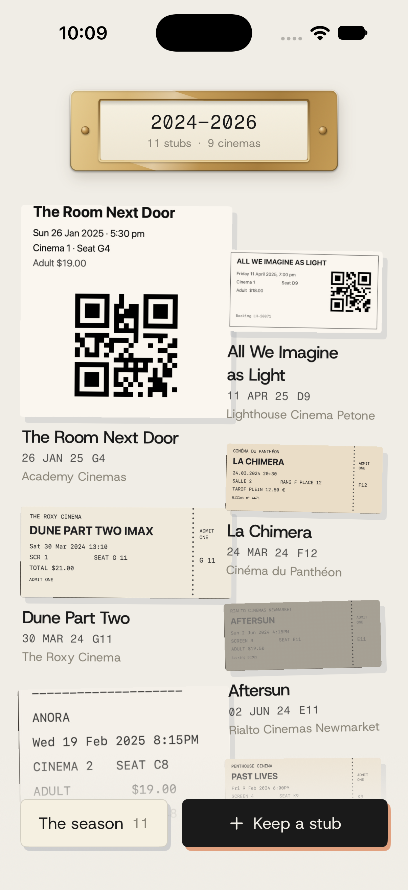
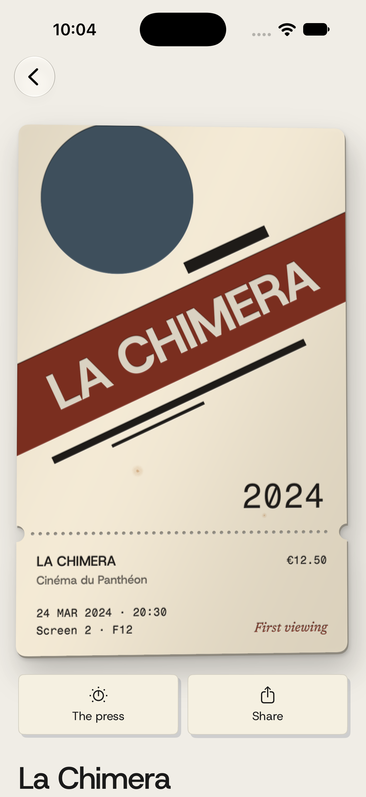
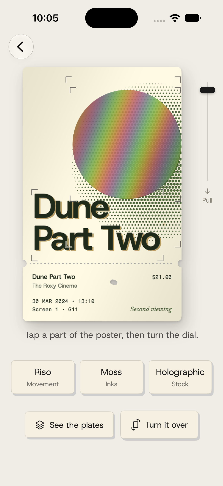
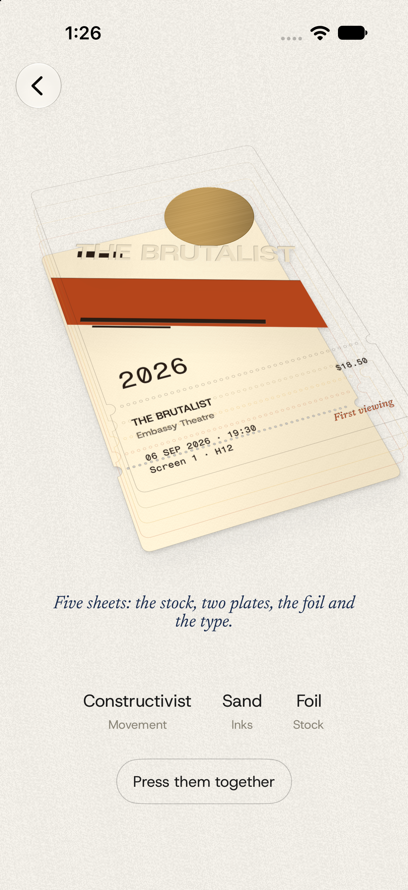
</p>

<sub>The drawer under its label · an edition · the press, every part that turns marked · the card taken apart into its plates</sub>

## The record

This repo is the case study. [`docs/decisions/`](docs/decisions/) is the product record: each decision, the evidence for
it and what was killed to make room for it. [`DECISIONS.md`](DECISIONS.md) is the engineering log, [`DESIGN.md`](DESIGN.md)
the rules for the look, [`docs/LOG.md`](docs/LOG.md) what happened each day, failures included.

| | Decision |
|---|---|
| [001](docs/decisions/001-the-moment.md) | Stub is for one moment: walking out of the cinema |
| [002](docs/decisions/002-surfaces.md) | The surfaces that reach it without opening the app: a Lock Screen control, the share sheet, the Add to Stub link, Spotlight |
| [003](docs/decisions/003-kill-list.md) | The kill list |
| [004](docs/decisions/004-budgets.md) | Performance budgets on the oldest supported iPhone are the definition of done |
| [005](docs/decisions/005-accessibility.md) | Accessibility: every flow, every setting, an honest label |
| [006](docs/decisions/006-network-without-data.md) | Network effects without collecting data, and the business model |
| [007](docs/decisions/007-proof.md) | Proof outside us: [the kits](docs/proof/) |
| [008](docs/decisions/008-corpus.md) | The corpus: real tickets, measured by kind |

## Measured

Every budget is an Apple number or derived from one, on the oldest iPhone Stub supports (iPhone SE 2nd generation and
iPhone 11, A13): the first frame in 400 ms, scrolling and the reveal under 5 ms of hitches a second, a tap answered in
100 ms, a ticket keepable 1.5 s after the shutter. `StubUITests` measures them with `XCTApplicationLaunchMetric`,
`XCTOSSignpostMetric`, `XCTHitchMetric`, `XCTMemoryMetric`, `XCTCPUMetric` and `XCTClockMetric`; `scripts/budgets.py`
fails a run that is over, or that stopped measuring something; CI runs it on every push. What the measurements fixed, on
the SE 2 simulator, before → after:

| What a person feels | Before | After |
|---|---|---|
| Shutter to a draft you can keep, with the on-device model | 4.20 s (and ~8.9 s before the rules' draft went on screen first) | **1.50 s** |
| The reader's last word | 14.1 s | **9.7 s** |
| Keep to the press on screen | 0.31 s | **0.10 s** |
| Keep to saved | 0.34 s | **0.03 s** |
| Launch to responsive | 5.29 s | **4.68 s** (the simulator's own dyld is most of what is left) |
| The drawer's main-thread time recounting itself, card by card | 9.9% | **0.4%** |
| Motion managers running at once | 5 | **1** |

Hitches, energy and the model on the Neural Engine are measured only on a phone, and the phone lane waits for signing
([decision 004](docs/decisions/004-budgets.md)).

## For everyone

Apple's accessibility audit runs on every screen a common task passes through, at the default and the largest text
size, with and without Increase Contrast, in CI. The audit is a heuristic: it failed ink at 14:1 and passed a grey at
3.2:1. So every issue it raises is judged on evidence. Contrast is measured on the screen, type is measured growing,
and Vision reads the words where they are drawn. Anything evidence does not settle fails the build. It found the press's
part chips out of VoiceOver's reach, a word broken in two on a small phone, words cut at the largest sizes, a warm grey
at 3.2:1 and an engraving at 2.1:1. All are fixed. Words are set level and never under 12 points. Reduce Motion has a
still for every movement. The Accessibility Nutrition Label claims only what a person has done end to end
([decision 005](docs/decisions/005-accessibility.md)).

## Private, and still a network

No account, no server, no analytics. The network runs on what people choose to do: the 9:16 share is worth posting and
carries the cinema's name; a cinema's confirmation can carry an **Add to Stub** link, and what it gets back is its name
in its audience's Stories and tickets kept exactly right, never data; and a person who corrects a misread ticket can send
its **shape**, never what it says, so every phone reads that cinema's tickets right in the next update. Installs from
shares are counted by Apple's aggregated campaign reports, not by Stub ([decision 006](docs/decisions/006-network-without-data.md)).

---

## Three objects

### The drawer

The home is a cabinet. **Every stub** is the cabinet's own engraved brass plate, the total cut into it; the drawers you make wear brass holders with a typed card. Stubs stand in year folders that close like a desk's, in the order you put them, each keeping the tilt it was given when it was filed, between −1.5° and 1.5° and never level. The photograph is silkscreened onto parchment, with the orange plate a few points out of register. Hold a stub and its menu opens: file it in a drawer, or throw it away; hold it and move, and it is carried.

Vision reads the stub on the device. A rule-based parser reads it first, always. The on-device model then reads it with that draft in hand, and is scored against it. Every stub says who read it and how sure it was.

### The edition

Every release gets one design, and every stub of that release prints its own copy: the seat, the date, the cinema, and whether it was the first viewing or the third. The design comes from a closed vocabulary: eight movements, twelve palettes and four stocks. The on-device model chooses between those words; it never chooses a colour, a position or a letter. The release's hash draws everything under them, so there is always an edition, on any phone, before the model answers or if it never does.

<p>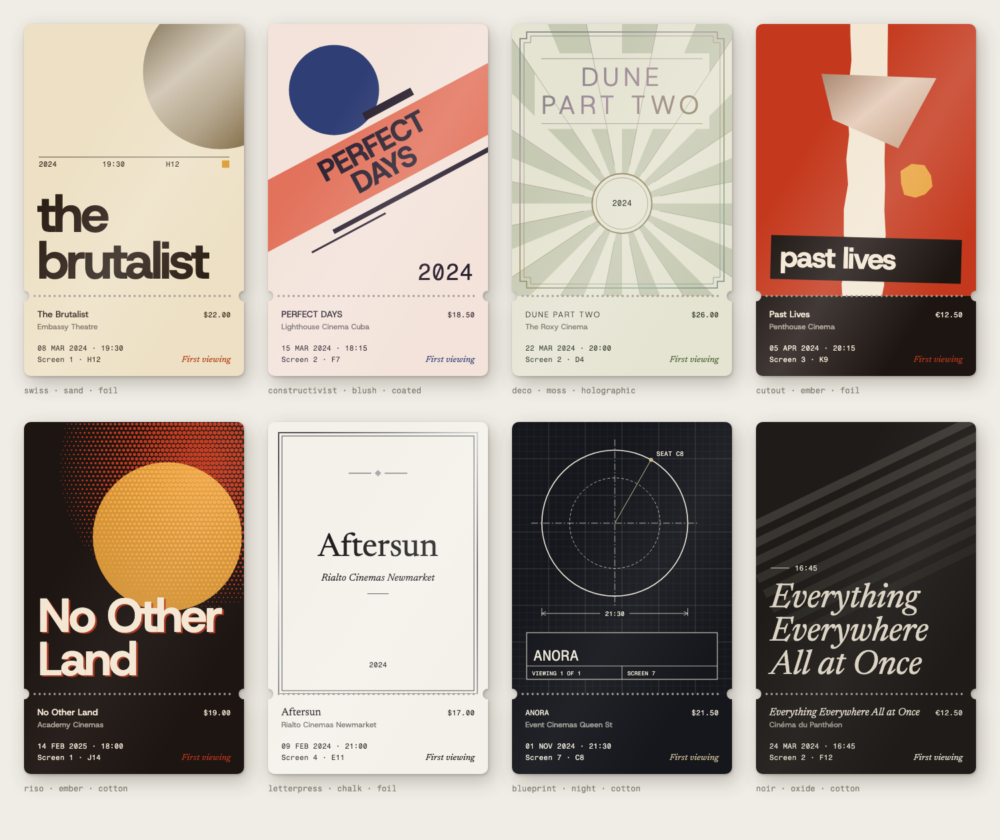</p>

<sub>All eight movements, drawn in a browser by <a href="docs/editions/edition.js"><code>edition.js</code></a>, which rolls the same dice in the same order as the Swift. It is a design tool and a specimen; the proof is the simulator.</sub>

The card is lit by one light, and it is the phone's. Tilt the phone and the light moves across the ink pressed into the stock, the foil, and the stock's own fibre and sheen: three Metal shaders sharing one light vector. Drag a finger across the card and you feel the stock: cotton drags, foil is slick, and the perforation clicks once. Turn it over and the stub you were handed is on the back, in four photo corners, above an Aztec code that encodes exactly what the strip prints.

### The press

The press gives you the power the model has, and one more: the card can be acted on, the way ephemera are made. Choose its movement, inks or stock from the same lists the model chooses from. Then **overprint** it: drag a finger across the card and a pass is pulled through a screen (the stub's own photograph as a silkscreen transfer, discs, dots, bands, the title's own letter) in one of its inks, multiplied into the paper. Or **stamp** it: tap and a rubber stamp of the night lands a few degrees crooked, the date, Admit one, the seat, the viewing, the cinema's postmark. Every act is the card's own ink through a form the edition already speaks, so nothing can break the design; "Take it off" lifts the last one, and the lever keeps it.

<p>
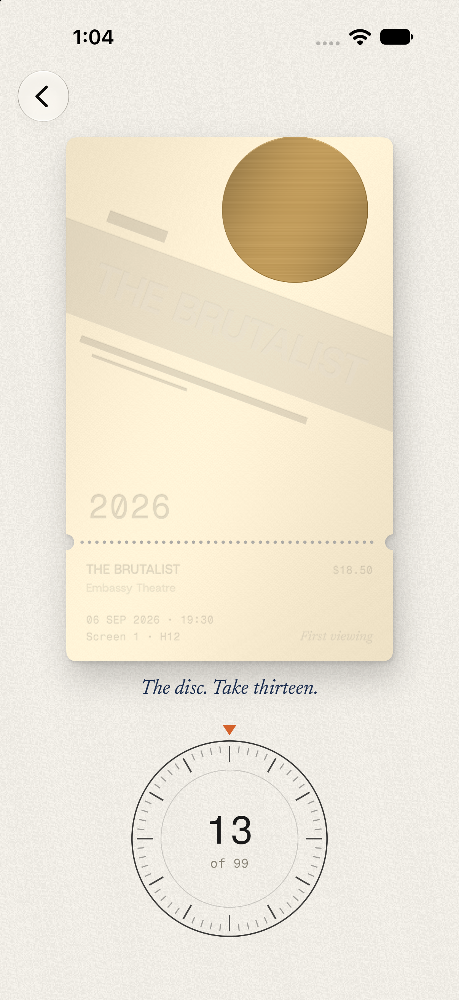
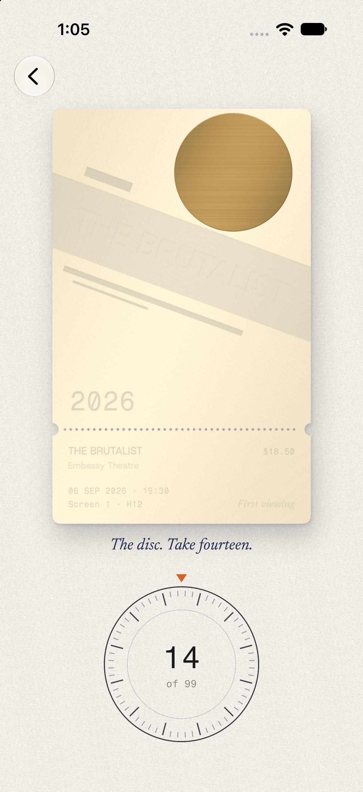
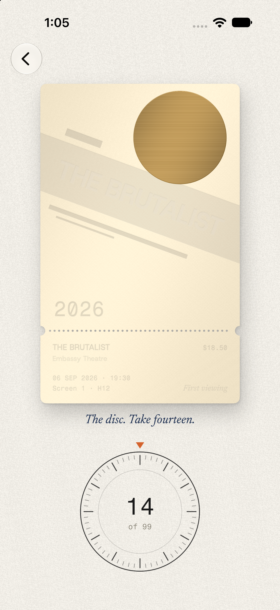
</p>

<sub>Take 13, the in-between, take 14. The wheel doesn't cut from one drawing to the next; it draws the space between them, the way an animator draws in-betweens. Only the part you're holding moves. <a href="docs/screenshots/day-24-press.mov">Watch the wheel turn</a>.</sub>

This works because every part of the poster rolls from a die of its own (`Dice.fork`), so a part can be redrawn without moving any other. A test holds all eight movements to that rule, across twenty takes of every part. Pinch the card and it comes apart into the layers it was printed in, so a part buried under another can be reached on its own sheet ([film](docs/screenshots/day-25-separations.mov)).

What the press keeps isn't an image. It's the difference between your card and the title's:

```json
{"pulledAt":"2026-09-27T23:48:29Z","release":"la chimera","takes":{"blueprint/circle":7,"blueprint/radius":3},"version":2}
```

That is 122 bytes, and it prints the same card on every phone. Going back is deleting it. The long version is [`docs/post-press.md`](docs/post-press.md): re-rolling one part of a poster without moving the rest, from `Dice.fork` to the wheel.

### The card keeps its history

A second viewing of a release punches the strip, the way a conductor punches a ticket, in the movement's own die: noir's is a crescent, riso's is two discs out of register, deco's a stepped diamond. The punch goes through both faces and lands clear of every word and of the code on the back. The card also ages from the night it was seen. The stock warms, a spot of foxing comes up every eighteen months or so, and the corners fray. It's the same on every phone and changes only as the calendar does.

Hands wear it too: each time a card is taken out its corners soften and a burnish comes up where a thumb holds it, seen only as the light moves, and the detail says in one line what every mark means. Share it and you get the still or three seconds of the card turning while the light crosses the foil.

<p>
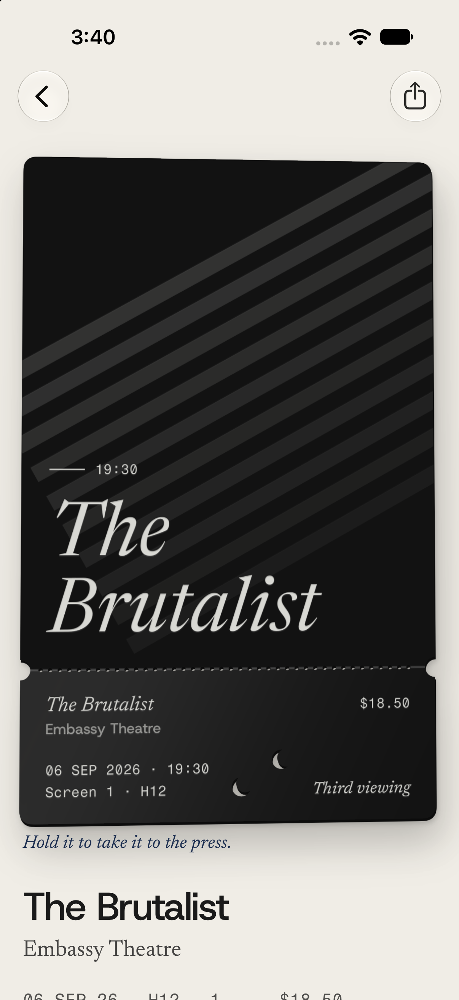
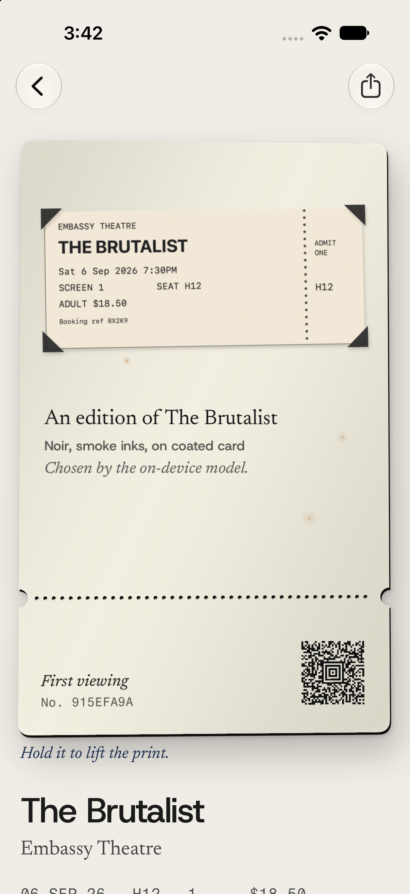
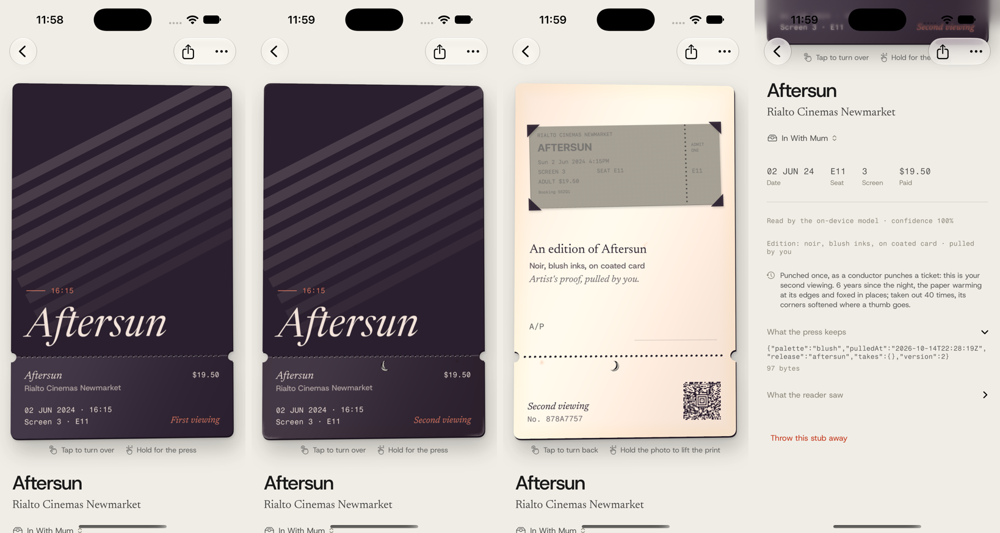
</p>

<sub>A third viewing, punched twice · six years in the drawer · what the marks mean. <a href="docs/screenshots/day-30-clip.mp4">The moving share</a>.</sub>

---

### Ways in, and ways out

The fastest way in is the **Keep a stub** control, on the Lock Screen, in Control Centre or on the Action button: one press from a pocket to the viewfinder. A ticket that never had paper comes in through the share sheet: a **booking email's words**, selected and shared; a **Wallet pass**, read from its own fields (the film, the cinema, the time, the seat, as the pass states them; no camera, no model), a **PDF e-ticket** from its own text, a **screenshot** as a photograph. A booking confirmation can carry an **Add to Stub** link ([the spec](docs/add-to-stub.md)) that opens the import sheet prefilled; nothing is filed until you keep it, and nothing is fetched to open it. The drawer **outlives the phone** in your private iCloud, the press's proofs and your signature with it, and every stub knows its venue and its circuit.

Every share says **shared in Stub**, pressed into the parchment under the card like a paper mill's watermark. The moving share is 9:16, so a Story shows all of it.

<p>
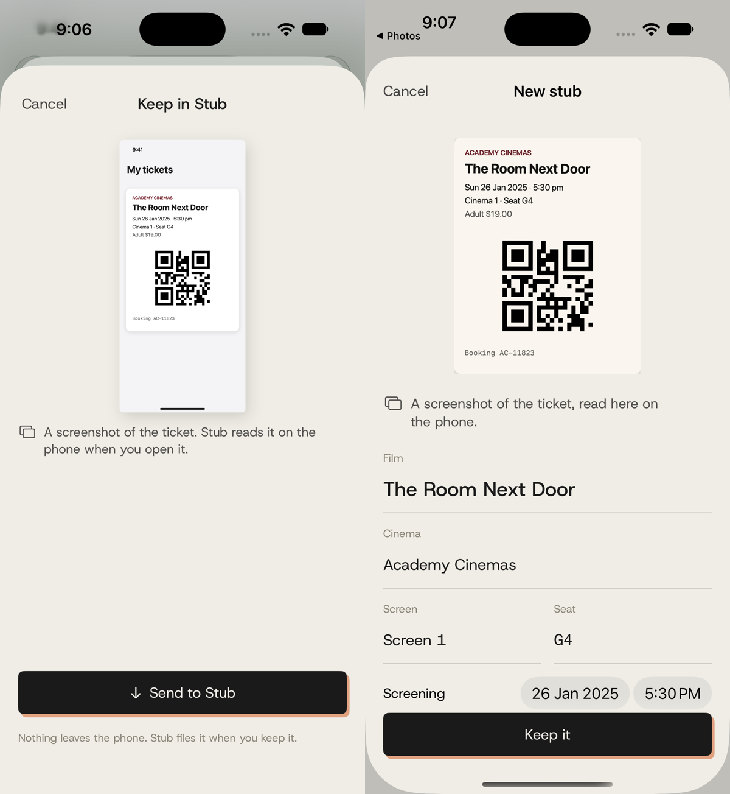
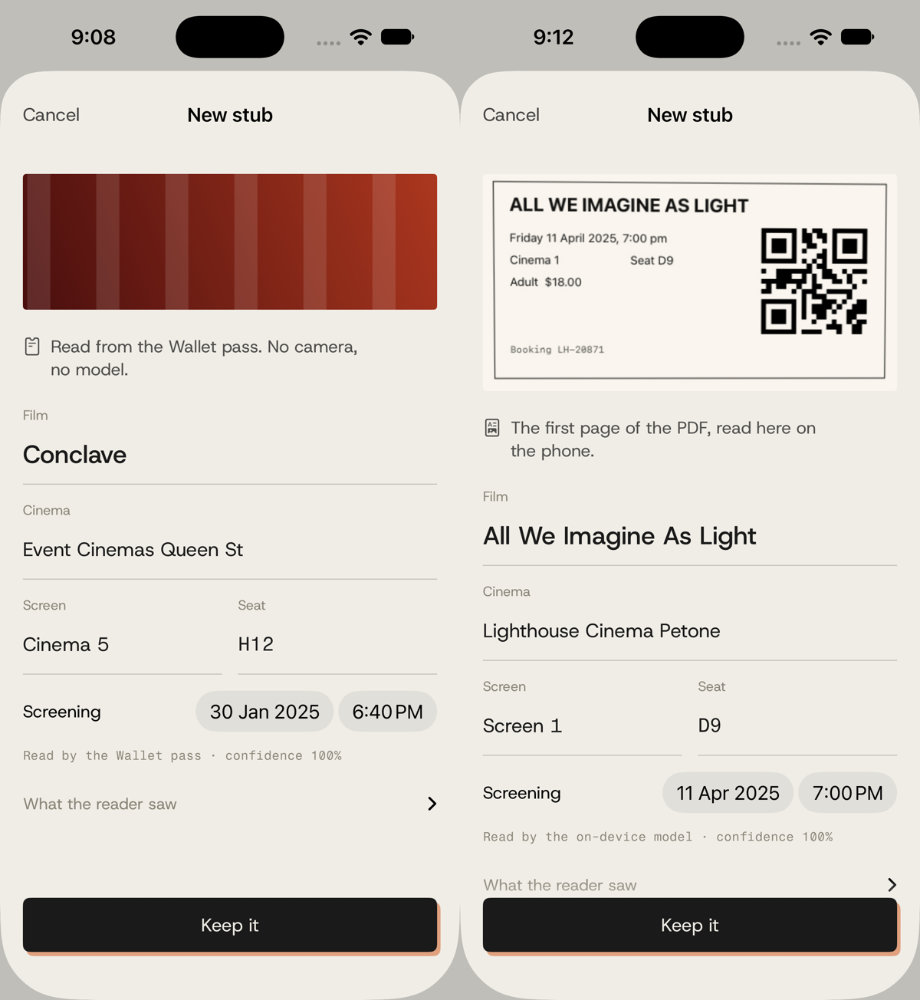
</p>

<p>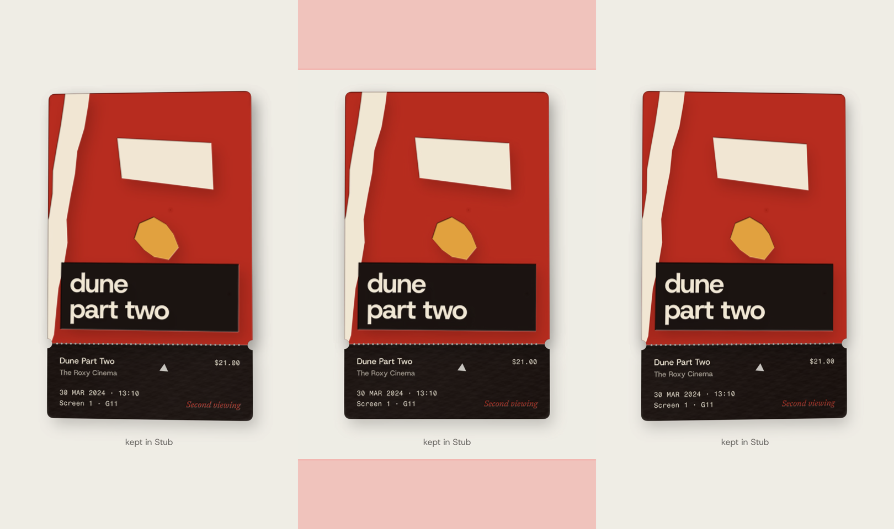</p>

## Tuned by hand

Every number here was set on purpose, and most were tuned by eye and thumb. The ones marked *device* still need a real phone to confirm the feel.

| | Value | Why |
|---|---|---|
| A stub's tilt | −1.5° to 1.5°, never 0, fixed when filed | Nothing on the table sits level |
| Press spring | response 0.34, damping 0.55 | Overshoots about a fifth once, then settles: a button pressed into the page |
| Reduce Motion | response 0.26, damping 1 | Critically damped, no overshoot, no tilt |
| The card's lean | up to 11° from the phone's attitude | Smoothed at 0.22 so the light follows the hand, not its tremor |
| The stock under a finger | sharpness 0.15 cotton → 0.85 holographic | Paper feels dull, metal bright *(device)* |
| The studio | four screens, five stamps, three inks; a stamp a few degrees crooked, a pass multiplied into the card | Acting on the card feels like a print studio, never like editing *(device)* |
| A flick | coasts at 0.93 per 16 ms above 0.25°/ms | Then settles on the nearest take with one overshoot |
| Detents | a ratchet when they come faster than one per 28 ms | Single clicks at that speed blur into mush *(device)* |
| A ghosted part | 18% of its ink, drawn toward the stock | Only the part in hand reads |
| Separations | 52° back, −24° turned, 38 pt a sheet | A printer's view of the card's layers |
| The lever | 150 pt of travel, gives at 92%, resistance 0.1 → 0.8 | Committing is physical; there is no Save button *(device)* |
| Wet ink | dries over 2.4 s, then the timeline stops | The one thing that moves on its own, and it ends |
| A proof | about 120 bytes | A few numbers laid over an edition, not a picture of one |
| A punch | 16 pt across, 3 pt clear of any word | Smaller and a cut shape reads as a printed glyph |
| Patina | warmth 0.42 (1 − e^(−years/4.5)), foxing from the first year, one spot every eighteen months, seven at most | Quick at first, then hardly at all; rare |
| The moving share | 3 s at 60 fps, tilt −0.35 → 0.35, HEVC, 1080 × 1920 | The card and its watermark clear of a Story's 250-pixel bands; about 1 MB, drawn in 11.5 s in a Debug build, when a destination asks for it |
| The watermark | "shared in Stub", 15 pt, blind-embossed: a shade of the paper, lit and shaded along its edges by the share's own light | Read by its relief, never ink on the card, always there |
| A button | a capsule in the drawer's inks; down a touch with its shadow drawn in, one soft tap at contact, back on one spring | Clean and quiet; the misregistration belongs to what is printed ([ADR-029](DECISIONS.md)) *(device)* |
| The deal | 55 ms a card, from 26 pt up and 4.5° further turned, spring 0.5 / 0.62 | Cards put down on a table one by one, never faded in |
| The plates | brass, the sheen 110 pt across a full tilt, growing with the text size | Every stub engraved with its total; a drawer you make, a typed card ([ADR-036](DECISIONS.md)) |
| The reader's patience | the rules' draft at once; the model for 8 s | Nobody waits at the cinema door for a second opinion ([ADR-037](DECISIONS.md)) |
| The App Store preview | 25 s, 886 × 1920 and 750 × 1334, 30 fps | Filmed from the app and cut, never sped up (`scripts/preview.sh`) |

## How it's built

| | Apple technology | In Stub |
|---|---|---|
| **Read** | Vision `RecognizeDocumentsRequest`, `RecognizeTextRequest` | The printed lines, in reading order |
| **Crop** | `DetectDocumentSegmentationRequest`, `DetectRectanglesRequest`, Core Image | The card is the ticket, not the table it lay on. Two detectors, because one lies in the simulator ([ADR-007](DECISIONS.md#adr-007--two-detectors-for-the-crop-and-a-quadrilateral-that-hugs-the-frame-is-not-a-ticket)) |
| **Understand** | Foundation Models: `@Generable`, streamed snapshots | The model reads with the rules' draft as a hint; the rules are the floor ([ADR-001](DECISIONS.md#adr-001--the-heuristic-parser-is-the-floor-the-model-is-measured-against-it), [ADR-010](DECISIONS.md#adr-010--the-model-reads-with-the-heuristics-draft-in-hand-and-is-scored-in-the-drawers-shapes)) |
| **Say** | Foundation Models | One dry sentence about the drawer: the numbers are counted by hand, only the phrasing is the model's, and the sentence is judged on the way out ([ADR-011](DECISIONS.md#adr-011--the-season-is-counted-by-hand-and-only-phrased-by-the-model)) |
| **Look** | Metal `[[stitchable]]` shaders in SwiftUI | Silkscreen and misregistration on flat parchment, specified at the modifier boundary so Metal is an implementation, not the identity ([ADR-002](DECISIONS.md#adr-002--the-look-is-specified-in-swiftui-first-metal-is-an-implementation-not-the-identity)) |
| **Print** | `@Guide(.anyOf(…))`, Metal, Core Motion, Core Haptics | The model art-directs from a closed vocabulary; the hash draws; one light ([ADR-015](DECISIONS.md#adr-015--every-release-gets-an-edition-the-hash-draws-it-the-model-art-directs-it-from-a-closed-vocabulary)) |
| **Press** | SwiftUI `Canvas`, `projectionEffect`, Core Haptics | Parts, takes, in-betweens, separations; a proof is a diff ([ADR-016](DECISIONS.md#adr-016--the-press-a-proof-is-a-diff-over-the-edition-and-every-part-has-its-own-die)) |
| **Share** | `ImageRenderer`, AVFoundation | The still, and three seconds of the card turning in the light, drawn frame by frame through the same shaders |
| **Keep** | SwiftData (versioned), an App Group, a CloudKit private database | On the device and in your own iCloud; no account of ours, no server ([ADR-005](DECISIONS.md#adr-005--private-by-construction), [ADR-012](DECISIONS.md#adr-012--one-drawer-in-an-app-group-the-app-writes-it-the-widget-reads-it-an-intent-runs-inside-the-app), [ADR-024](DECISIONS.md)) |
| **Take in** | A share extension, the Wallet pass format, PDFKit | Passes read from their fields, PDFs from their text, screenshots as photographs; left in an inbox for the app, the drawer's one writer ([ADR-023](DECISIONS.md)) |
| **Reach** | Controls, App Intents, App Entities in Spotlight, universal links, WidgetKit, AVFoundation | Keep a stub on the Lock Screen and the Action button; stubs in Spotlight; Add to Stub links and the Keep a ticket action ([ADR-021](DECISIONS.md), [ADR-040](DECISIONS.md)); the drawer's editions on the home screen ([ADR-027](DECISIONS.md)); a viewfinder whose marks lock onto the ticket ([ADR-025](DECISIONS.md)) |
| **Measure** | `os_signpost`, XCTest performance metrics, Instruments, MetricKit | Budgets on the oldest phone, judged in CI; field reports kept on the phone ([ADR-038](DECISIONS.md), [ADR-041](DECISIONS.md)) |
| **Access** | VoiceOver, Dynamic Type, Reduce Motion, Increase Contrast, `performAccessibilityAudit` | Every card says what it knows; nothing in the interface shrinks to fit; a rotor for the parts of a poster; the audit in CI ([decision 005](docs/decisions/005-accessibility.md)) |

---

## Built in the open

One day at a time, each day proved by a screenshot of the real app running in the simulator. The plan is in [`PLAYBOOK.md`](PLAYBOOK.md), the decisions in [`DECISIONS.md`](DECISIONS.md), the rules for the look in [`DESIGN.md`](DESIGN.md), and what actually happened each day, failures included, in [`docs/LOG.md`](docs/LOG.md).

| Day | Shipped | Proof |
|---|---|---|
| 0 | The skeleton: the model, the reader, two parsers, the look, the table, the seed path | 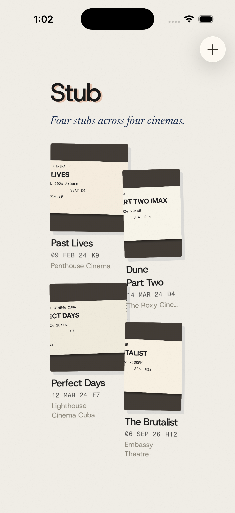 |
| 1 | The look moves to Metal; the reader crops the ticket out of the photograph | 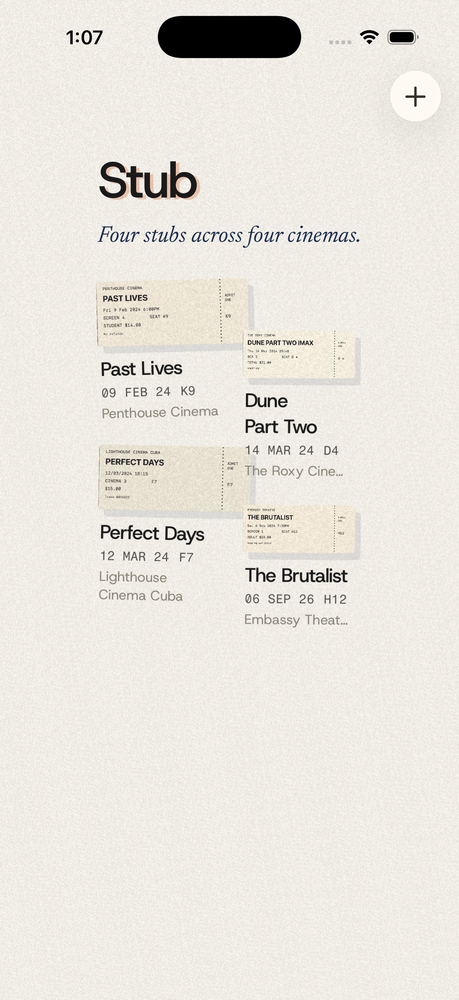 |
| 2 | The zoom transition, press physics, hold to lift the silkscreen | 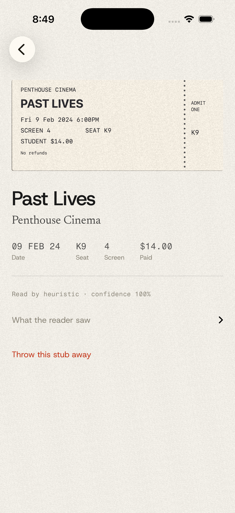 |
| 3 | The model streams, reads with a hint, and is scored; the eval harness | 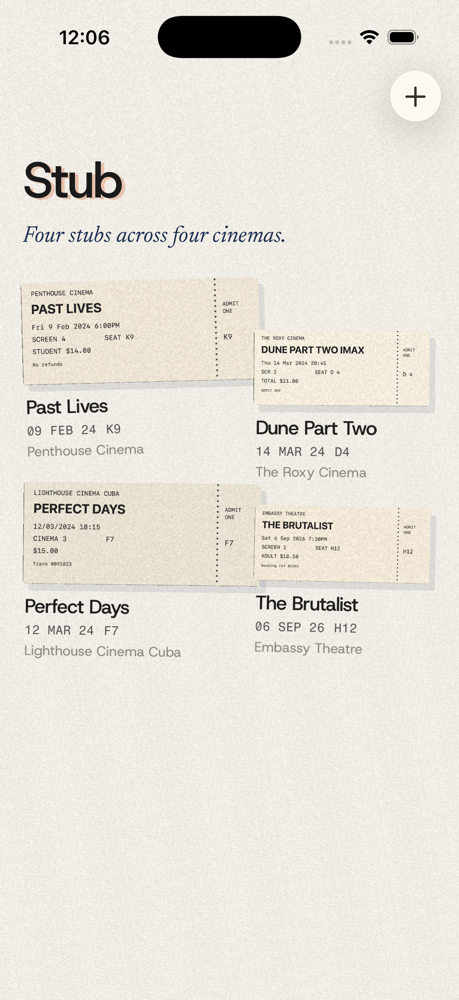 |
| 4 | The season sentence, counted by hand and phrased by the model | 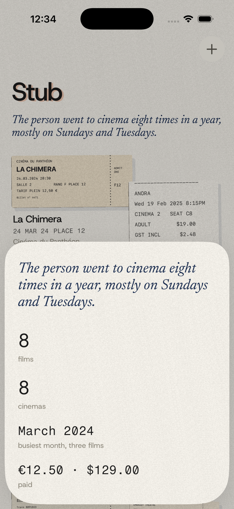 |
| 5 | App Intents, the widget, the drawer in an App Group | 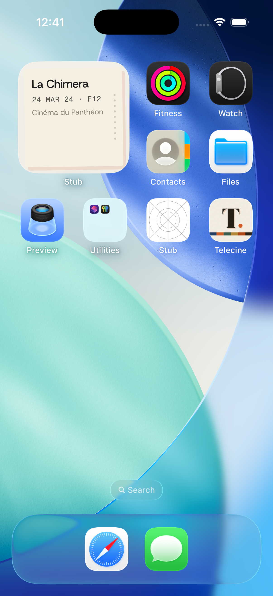 |
| 6 | The camera path, the icon, the accessibility pass | 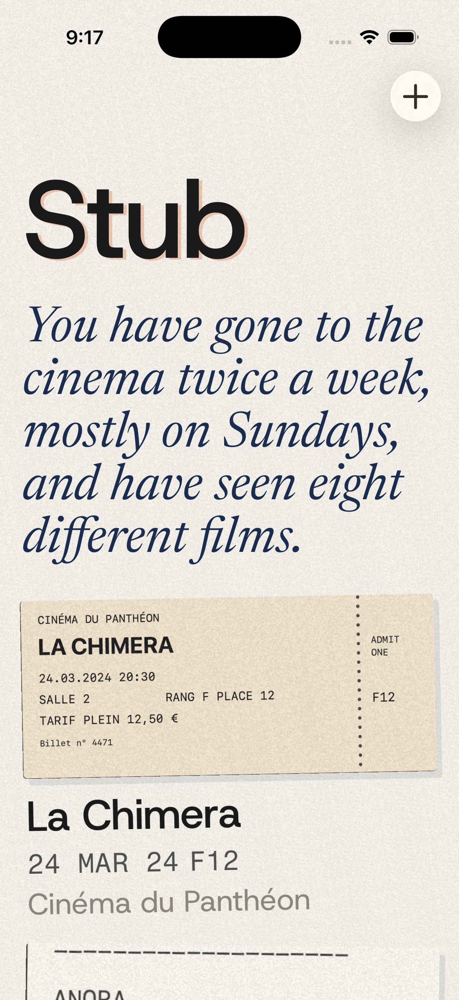 |
| 7 | The write-up, [`docs/post.md`](docs/post.md), `v0.1.0` | 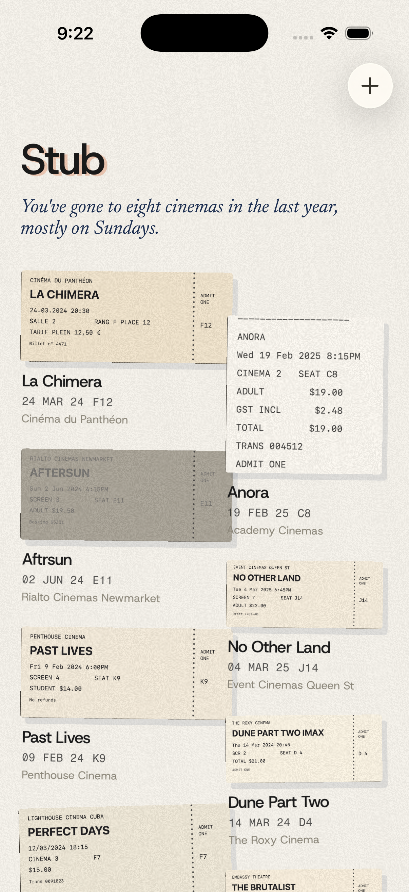 |
| 21 | Editions: eight movements, three shaders, the art director, the card in the hand | 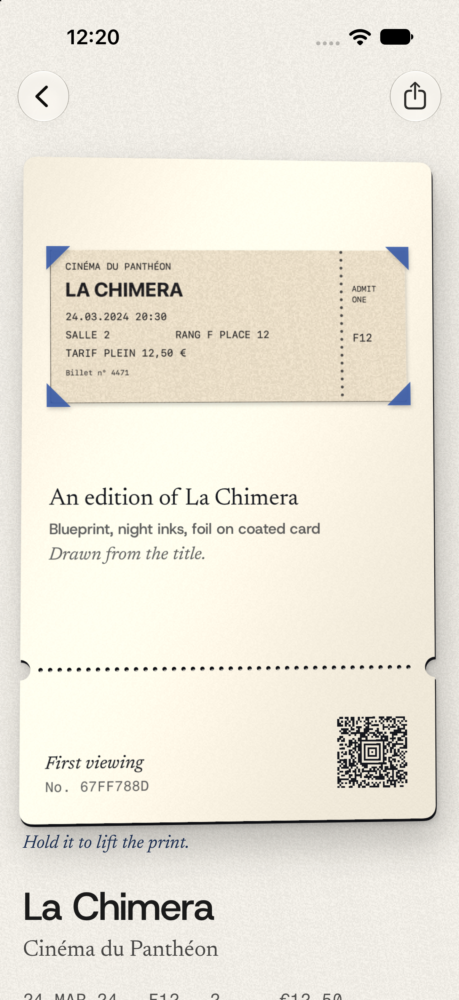 |
| 22 | Day 21 built: 2,600 lines written without a compiler, with one warning between them | 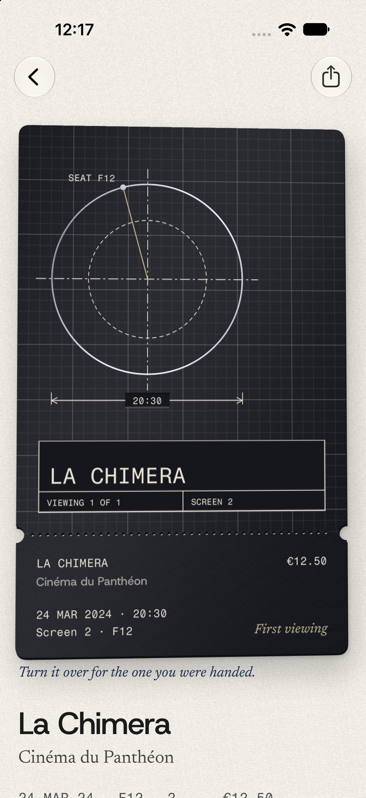 |
| 23 | Parts, takes and the proof ([the brief](docs/briefs/the-press.md)) | 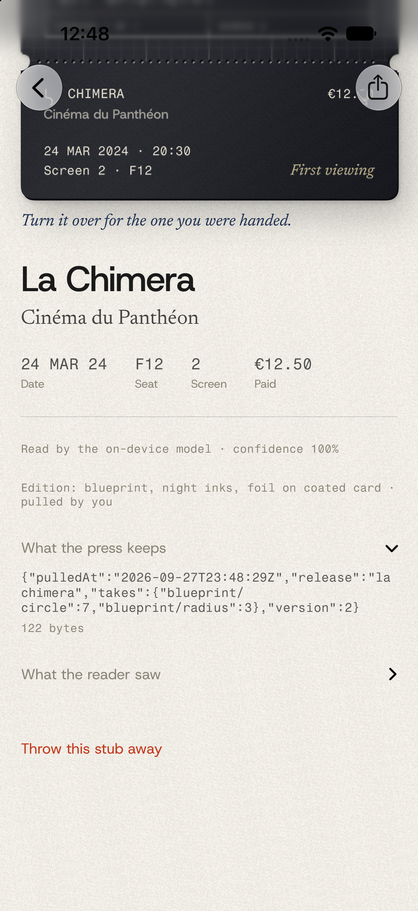 |
| 24 | The press room, the wheel, the in-betweens |  |
| 25 | Separations |  |
| 26 | The fan of movements, the draw-downs that flood the card, the swatch book | 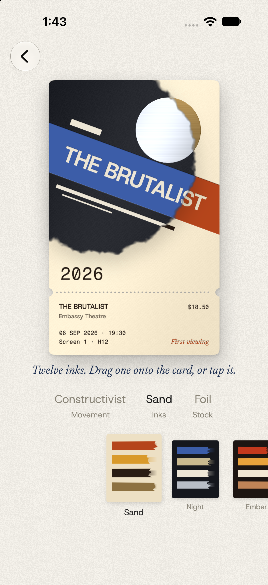 |
| 27 | The lever and the platen, wet ink, undo, and the back: signed, A/P, the takes in pencil | 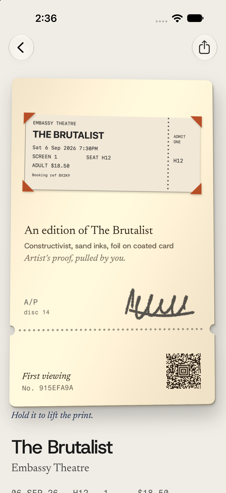 |
| 28 | The punch and patina: a remarque for every viewing after the first; the card ages from the night |  |
| 29 | The room's light: the card on a real table, lit by the room ([ADR-018](DECISIONS.md#adr-018--the-rooms-light-on-a-real-table-the-card-is-lit-by-the-room)) | 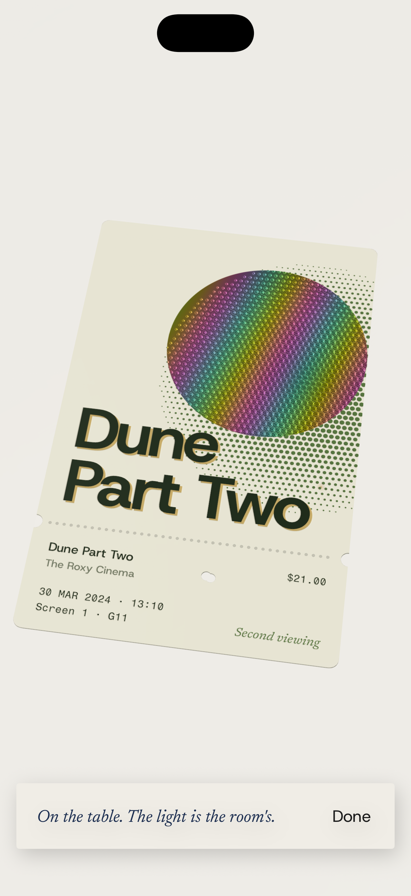 |
| 30 | The moving share, and the write-up, [`docs/post-press.md`](docs/post-press.md) | 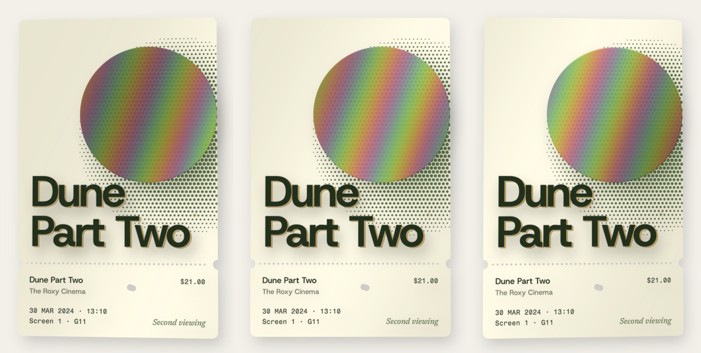 |
| 13 Oct | Add to Stub; Wallet passes, PDFs and screenshots shared in; the drawer in iCloud, venues and circuits; the 9:16 share and its watermark; the home's label, the press's marks, the icon; the App Store preview | 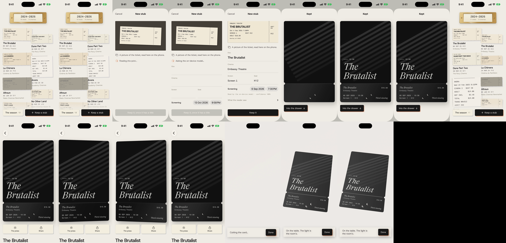 |
| 15 Oct | The cabinet and year folders, the camera first, the widget as the edition, Your card, ten icons, the dial's named moves, patina from hands | 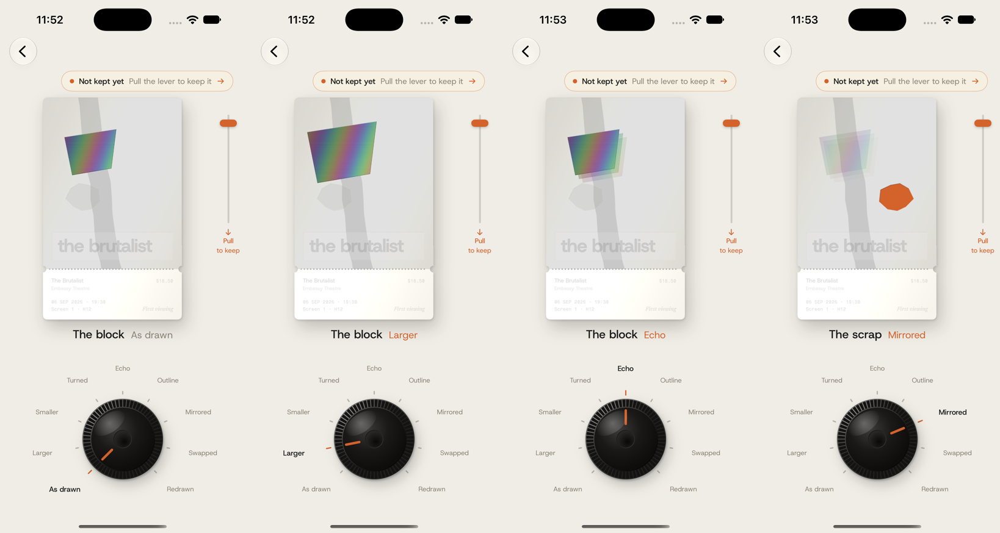 |
| 16 Oct | The moment, measured: the record, budgets in CI, accessibility audited, a Lock Screen control, Spotlight, booking emails, the season set as a record; a rewatch pulls a variant, so no two stubs are alike; every edition has a hand; the press's studio: overprint and stamp the card | 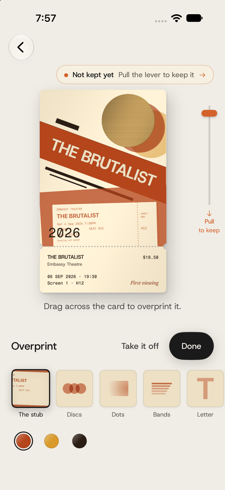 |

## Run it

You need Xcode 27 with an iOS 27 simulator (the app still targets iOS 26; [ADR-014](DECISIONS.md#adr-014--the-simulator-is-ios-27-the-app-still-targets-ios-26)) and [XcodeGen](https://github.com/yonaskolb/XcodeGen) (`brew install xcodegen`). Turn Apple Intelligence on for the Mac to use the on-device model.

```bash
git clone https://github.com/brunohart/stub && cd stub
scripts/build.sh      # xcodegen, then a simulator build
scripts/test.sh       # the tests on an iPhone 18 Pro; the eval suite asks the model for a few minutes
scripts/eval.sh 3     # the deep eval: every question asked three times, into docs/evals-deep.md (half an hour or so)
scripts/eval.sh --corpus   # the real tickets in corpus/ (kept off git), into docs/evals-corpus.md
scripts/perf.sh       # the performance budgets on an SE 2 simulator; --device <udid> on the oldest phone
scripts/a11y.sh       # the accessibility audit, with and without Increase Contrast
scripts/run.sh --seed --reset --wait-for "written|hand-counted" --shot docs/screenshots/now.png
```

The simulator has no camera, no gyroscope and no hands, so `run.sh` stands in for them:

| Flag | Does |
|---|---|
| `--seed --reset` | Runs the eleven synthetic tickets in `fixtures/` (nine photographed stubs, an e-ticket PDF, a screenshot) through the real reader |
| `--edition [--open "Title"]` | Opens a stub so its edition is chosen and printed; `--turned` shows its back |
| `--tilt x,y` | Holds the light where a screenshot wants it |
| `--press --overprint stub --stamp date` | Carries the card into the press, pulls a pass through the stub's own photograph and stamps the date; `--ink secondary` chooses the ink |
| `--separated 0.8` | Pulls the card's layers apart |
| `--proof "disc=14,bars=3"` | Pulls a proof; `--keeps` shows what the press keeps |
| `--bench movement` · `--flood 0.4` | Opens the fan, the draw-downs or the swatch book; holds a flood part-way |
| `--pulled --wet 0.6` · `--signed` | Pulls the proof on the press and holds the ink wet; signs with a fixture signature |
| `--viewings 3` · `--age 6` | Punches the card as a third viewing; ages it six years |
| `--clip out.mp4` | Draws the moving share (9:16, watermarked) and copies it out; `--clip-card` draws the card-sized one |
| `--inbox file` | Puts a `.pkpass`, a PDF or a picture in the share extension's inbox, as a share would |
| `--preview` | Plays the App Store preview's story; `scripts/preview.sh` films it and cuts it to Apple's sizes |
| `--drive [--record out.mov]` | Plays the interactions on a clock, and films them |
| `--type accessibility-extra-large` | Sets Dynamic Type for the run |

On a phone, once the account is set up ([`docs/device.md`](docs/device.md) §1):

```bash
scripts/device.sh     # a signed Release build, installed and launched on the paired iPhone
scripts/archive.sh    # archive and export for TestFlight; --upload sends it to App Store Connect
```

## What the readers score

A test runs every fixture through the real pipeline and writes [`docs/evals.md`](docs/evals.md). The run of 16 October 2026, on the iOS 27 simulator, with eleven **synthetic** fixtures we drew ourselves: nine photographed stubs, a PDF e-ticket (read from its own text) and a screenshot of a ticket in an app. They prove the pipeline, not the world; real tickets are measured by kind in [`docs/evals-corpus.md`](docs/evals-corpus.md) as they arrive ([decision 008](docs/decisions/008-corpus.md)).

| Field | rules | model, cold | model + the rules' draft |
|---|---|---|---|
| title | 11/11 | 11/11 | 11/11 |
| cinema | 11/11 | 9/11 | 11/11 |
| date | 11/11 | 10/11 | 11/11 |
| screen | 11/11 | 11/11 | 11/11 |
| seat | 11/11 | 10/11 | 11/11 |
| price | 11/11 | 11/11 | 11/11 |

The rules take about a millisecond; the model takes seconds and its latency swings between runs on the same Mac. Given the rules' draft, it matches them on every field. It isn't the same reader twice, so the table is a sample, and the log records the runs that scored differently. A Wallet pass isn't in the table: it is read from its own fields, not by either reader. [`docs/evals-deep.md`](docs/evals-deep.md) asks every question three times: how far one pass can be trusted, how fast the streamed title arrives, how often the season sentence keeps its rules on the first try, and whether the model gives a release the same edition every time.

## Honesty

On Day 0 the on-device model said it was available and then refused every request. The rules filed every fixture anyway, and that is why they are the floor and why every stub records who read it. On Day 1, Vision's document segmentation confidently returned a strip of table for every ticket, and a plain rectangle detector became the second floor. Day 21's editions were written on a machine with no Swift compiler and judged in a browser. They compiled on the first try on Day 22, and the log says what that session did and didn't catch.

What isn't proved yet: anything on a phone. The camera, the Keep a stub control and the Siri phrases, the lock-screen widget, Spotlight, an Add to Stub link tapped in Mail, a real Wallet pass shared from Wallet, two devices sharing one drawer through iCloud, and everything you feel rather than see (the gyroscope, the haptics, the buttons, the dial's detents, the foil in moving light) need a signed build on a phone and the account behind it ([`docs/device.md`](docs/device.md)), and so do the device lane's budgets: hitches, energy, and the launch and memory numbers on an A13. No one but Bruno has kept a ticket in Stub yet; [`docs/proof/`](docs/proof/) is how that changes. The three passes in `fixtures/passes` are synthetic, in Apple's format; real ones, redacted, will join them. The model art-directed its first editions in the simulator on Day 28 (The Brutalist as noir, La Chimera as constructivist), but its latency swings from about two seconds to about eighteen between runs on the same Mac, so plenty of editions still fall back to the hash after twelve seconds. Each day's log ends with a "Still rough" paragraph.

## Licence

MIT for the code. The fonts are Host Grotesk, Newsreader and Fragment Mono, under the SIL Open Font License, in `Stub/Resources/Fonts`.
